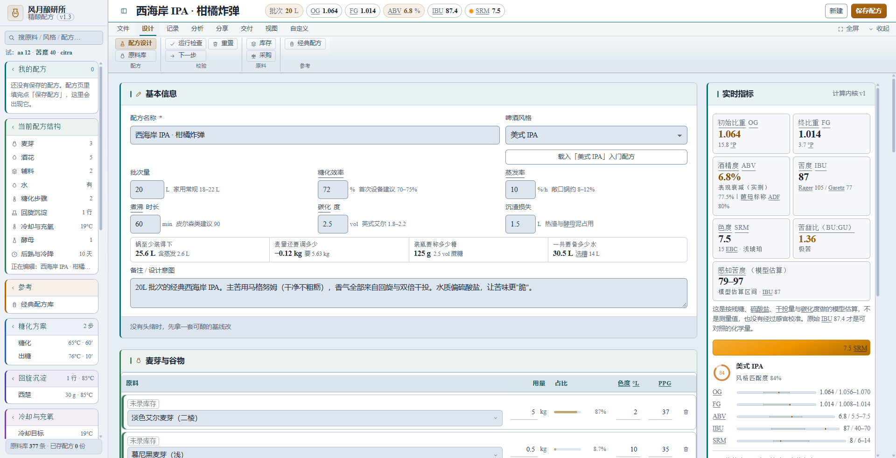
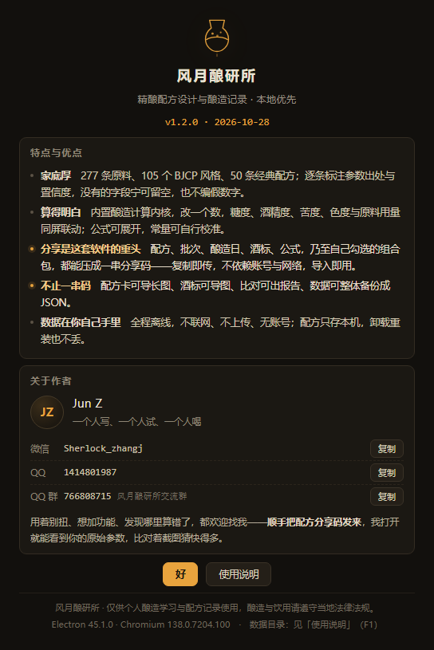

<div align="center">

[简体中文](README.md)　·　**English**

</div>

<div align="center">

# Fengyue BrewLab

**Recipe design & brewing log · local-first**

277 ingredients　·　105 BJCP styles　·　50 classic recipes　·　real-time calculation engine　·　share a recipe as a single code

Windows 10/11　|　Android 7.0+　|　Fully offline — no network, no upload, no account

</div>

<div align="center">

[**Live demo (no install)**](https://zj1414801987.github.io/fengyue-brewlab/)　·　[**Download for Windows**](https://github.com/Zj1414801987/fengyue-brewlab/releases/latest)　·　[**Download for Android**](https://github.com/Zj1414801987/fengyue-brewlab/releases/latest)

</div>

<div align="center">



<sub>Recipe editor: ingredients on the left, parameters in the middle, live metrics on the right — change one number, everything updates.</sub>

</div>

---

## Contents

- [What this is](#what-this-is)
- [Main features](#main-features)
- [The share code](#the-share-code)
- [Download & install](#download--install)
- [System requirements](#system-requirements)
- [Keyboard shortcuts](#keyboard-shortcuts)
- [Data & privacy](#data--privacy)
- [Source code](#source-code)
- [Roadmap](#roadmap)
- [Version history](#version-history)
- [Community](#community)

---

## What this is

Fengyue BrewLab (风月酿研所) is **a recipe tool built by a homebrewer, for homebrewers.**

It picks up where paper notebooks, spreadsheets and chat screenshots leave off: pick a style, fill in a few numbers, and gravity, ABV, bitterness, colour and ingredient amounts are computed as you type. After brew day, log what actually happened — the next batch is where you fix it.

No network, no sign-up, no uploads. Your recipes live on your own machine and phone. To show someone, you send a **share code**: one string of text they paste in, and every parameter of your recipe is restored on their side.

> The name: 风月 (fēng yuè) is the pleasant part of drinking; 酿研所 (niàng yán suǒ) is the lab where you take it seriously.

---

## Main features

### 1. Ingredient & recipe libraries

Not a list of names — data you can actually brew from.

| Library | Entries | What each entry carries |
|---|---|---|
| Malt & grain | 70 | Extract (ppg), colour (°L/EBC), max usage, diastatic power, needs mash?, flavour, suitable styles |
| Hops | 95 | Alpha acid, origin, aroma type, suggested addition stage, bitter/aroma tendency |
| Yeast | 59 | Attenuation, temperature range, flocculation, flavour profile, starter guidance |
| Adjuncts | 53 | Purpose, max usage, effect on body and foam |
| Water profiles | 10 | Typical city/style water, used for salt adjustment |
| BJCP styles | 105 | OG/FG/IBU/colour ranges, key flavour descriptors, common faults |
| Classic recipes | 50 | Split into editable ingredient rows, ready to use or adapt |

**Data honesty:** every ingredient is tagged with a confidence level — **A** = cross-checked across sources, **B** = single authoritative source, **C** = "check the maltster's COA before using". When a spec sheet isn't available, the field is left blank rather than filled with a made-up number.

### 2. Calculation engine

Change one number and the whole table follows — this is the foundation of the software.

- **Live linkage:** batch size, mash efficiency, ingredient amounts, hop additions — change any of them and gravity (OG/FG), ABV, IBU, colour (SRM/EBC) and the ingredient list recalculate together
- **Open formulas:** every metric expands to its full expression and source, e.g. `points = Σ(ppg × kg × 8.34540 × efficiency) / L`
- **Calibratable constants:** system efficiency, hop utilisation and other constants are adjustable, so the numbers match your actual equipment
- **Perceived bitterness:** 40 IBU tastes completely different depending on malt sweetness — the app reports how bitter it will *actually* drink, not just the formula output
- **Yeast starters:** how many steps, how much DME, how long each step — a plan you can follow
- **Water matching:** pick a target style and it works out how much sulphate and chloride to add, in grams

### 3. Recipe design & validation

- **Over-limit warnings that explain themselves** — not just "over the limit", but what happens: rye above 30% turns the mash to concrete, so add rice hulls and do a protein rest
- **Recipe check-up:** one click to scan for imbalanced ratios, out-of-range parameters and unit conflicts
- **Line-by-line diff:** compare two versions of the same beer and see exactly which row changed, by how much
- **Recipe genealogy:** every version records which version it came from, so a bad edit can be traced and rolled back
- **Inventory & shopping:** automatically calculates what malt and hops you still need

### 4. Batch logs & review

- **Recipe → batch → measurement:** one record per brew, including measured OG/FG, fermentation curve and predicted-FG deviation
- **Calibrate your system:** after three batches you know your rig's real extract efficiency
- **Brew-day timeline:** mash, sparge, boil, additions and chilling laid out on a timeline
- **Yearly stats:** how many batches, what they cost, which one is worth brewing again

### 5. Output & presentation

- **Recipe card:** export a long image for chat groups or your brewing notebook
- **Label designer:** design a bottle label for the batch you just made
- **Reports & printing:** laid out to real print geometry — export PDF or print on paper
- **Tasting scores:** 37 flavour anchors to score against, so you know what to adjust next time

### 6. A tool that teaches

- **121 glossary terms** — tap a term in context (mash, rest, diacetyl, attenuation) instead of leaving the app to look it up
- **82 knowledge cards** — shown where they're relevant: "why 65 °C for this step", "why late-hop this batch"
- Terms and cards are filed under metric / process / ingredient and surface by scenario, not dumped in a corner

---

## The share code

> In one sentence: **compress a whole recipe into a string you can paste into a chat window.**

### The problem it solves

Swapping recipes in the homebrew world has always been awkward:

| Old way | What goes wrong |
|---|---|
| Screenshot | Parameters cut off, ratios unreadable, the other person retypes everything |
| Send a spreadsheet | File transfer, version mismatch, broken fields |
| Cloud / drive link | Expires; the recipient needs an account, an app, and permission |
| Just describe it | "About 5 kg of malt, a couple of handfuls of hops" — vibes only |

The share code reduces this to **one line of text**:

```
BL2.eyJ0IjoicmVjaXBlIiwidi......(a long alphanumeric string follows)
```

Copy it into WeChat, QQ, a forum post or an email; the other person pastes it into **Import** and gets **the full ingredient list, parameters, label and notes** back exactly — including details you never wrote down separately.

No account, no network, no server. The string itself carries everything.

### What can be shared

Not only recipes:

| Type | Prefix | Contents |
|---|---|---|
| Single recipe | `BL1.` / `BL2.` | Full ingredient list, process parameters, notes, label reference |
| Bundle | `BZ1.` | Several items packed at once — "my four beers this season" |
| Formula profile | `BF1.` | Your adjusted constants and custom formulas, so someone else can compute the way you do |

In the **Share Center** you can tick any combination into one bundle:

- Recipes
- Batch records (including measurements and fermentation curves)
- Brew-day plans
- Labels
- Formulas

So you can send **how the batch actually went**, not just the paper recipe.

### Three steps

1. **Generate** — open Share, choose a type (recipe / batch / brew day / label / formula / custom bundle), generate, get a code
2. **Send** — copy it. Chat, forum, email, wherever
3. **Import** — the recipient opens Share → Import, pastes, and **sees a preview first**: what's inside and what will be written, item by item. Nothing is committed until they click **Confirm import**.

That preview step is deliberate: receiving a code should never silently overwrite your own recipes.

### Why it's reliable

- **Version embedded** — the code carries a format version. An older build opening a newer code says exactly that ("this code comes from a newer version, please upgrade") instead of producing garbage
- **Structural validation** — fields are validated after decoding; invalid records are dropped and counted, never half-written into your library
- **Explicit rejection** — text that isn't a share code (another app's JSON, say) is reported as such instead of being mis-imported
- **No network** — encoding and decoding happen entirely on your machine, so there is no "link expired" or "service shut down"
- **Readable, storable** — a share code is plain text: keep it in a note, write it next to the recipe in your notebook, paste it back ten years later

### Three real scenarios

**1. Asking for help in a group chat**
"My IPA finished harsh — did I add hops too early?" — attach the share code. Whoever helps imports it and sees your full parameters and water profile, instead of asking "what was your OG, what water, what mash temp?".

**2. A friend wants the recipe**
"Send me that oatmeal stout" — one code, faster than a file and more complete than a screenshot.

**3. Clone and iterate**
Import someone's recipe, change two parameters, save a version, then use the diff to see exactly what changed. After brewing, record the measurements and share the batch back. **That's how a recipe gets better in a community — one round at a time.**

> A share code is not cloud sync and not a backup. Its job is narrow and clear: **let a recipe travel between people without depending on any server.**

---

## Download & install

Latest build: **[Releases](https://github.com/Zj1414801987/fengyue-brewlab/releases/latest)**

| File | Size | Notes |
|---|---|---|
| `FengYue-BrewLab_Windows_v1.3_Setup.exe` | 101 MB | **Recommended.** Installer creates desktop and Start-menu shortcuts; uninstalls cleanly from Settings → Apps |
| `FengYue-BrewLab_Windows_v1.3_Portable.zip` | 141 MB | Extract and run, no registry writes. Good for a USB stick |
| `FengYue-BrewLab_Android_v0.1_debug.apk` | 5.4 MB | Android build (early: export and printing still being finished — try only) |

**About the installer**

- Installs to `C:\Users\<you>\AppData\Local\Programs\风月酿研所`; **no administrator rights needed**
- Recipe data lives **outside** the install directory, in `%APPDATA%\风月酿研所` — so **uninstalling and reinstalling does not lose your recipes**. Moving to another machine? Back up or use Settings → Export
- The build is not code-signed, so Windows may show "Windows protected your PC" on first run — click **More info → Run anyway**. That's the standard prompt for unsigned software

---

## System requirements

| Platform | Requirement |
|---|---|
| Windows | Windows 10 / 11 (64-bit), ~320 MB disk |
| Android | Android 7.0 or newer |
| Web demo | Any current Chrome / Edge / Safari / Firefox |

No .NET, Python, Java or other runtime needed — the runtime is bundled.

---

## Keyboard shortcuts

| Key | Action |
|---|---|
| `Alt` + `1`…`0` | Jump directly to recipe / process / batch / report views |
| `Ctrl` + `B` | Collapse or expand the left panel |
| `Ctrl` + `Shift` + `B` | Back up data now |
| `F1` | Open the built-in help |
| `Ctrl` + `=` / `-` / `0` | Zoom in / out / reset |
| `F11` | Full screen |

---

## Data & privacy

- **Fully offline:** no network calls, no uploads, no telemetry. Works with the cable unplugged
- **Yours to keep:** recipes are stored in `%APPDATA%\风月酿研所` and can be exported as JSON
- **Automatic backups:** a silent snapshot on every launch, keeping the last 10
- **No account:** there is no sign-up, no login, no phone number

---

## Source code

The application source is in [`src/`](src) — the same code that runs inside the v1.3 installer, taken verbatim from `resources/app.asar`.

**Stack**

| Layer | Choice | Notes |
|---|---|---|
| UI | Plain HTML / CSS / JavaScript | No framework, no bundler, no build step — edit and reload |
| Icons | Inline SVG + PNG | No icon font dependency |
| Data | `localStorage` | No database; recipes stay on your machine |
| Shell | Electron 45 | The main process only handles windows, menus, single instance, clipboard and backups |
| Installer | NSIS 3.10 | Per-user install, no admin rights |

**Layout**

```
src/
├─ main.js            Electron main process: window/zoom memory, menus, single instance, backups, crash fallback
├─ preload.js         Exposes exactly 4 methods to the About window
├─ package.json
├─ assets/            App icons (ico + multiple PNG sizes)
└─ web/               The application itself
   ├─ index.html
   ├─ css/            9 stylesheets layered by version; style.css is the base
   ├─ js/             58 modules loaded in numeric order (00-core → 60-app)
   └─ desktop/        Standalone windows: help.html, about.html
build/
└─ installer.nsi      NSIS installer script (reference template)
```

**Run locally**

```bash
cd src
npm install      # only Electron as a dev dependency
npm start
```

**Build a Windows installer**

1. `npx @electron/asar pack . ../build/app.asar`, then drop `app.asar` into the Electron runtime's `resources/`
2. Use `rcedit` to stamp the icon and version info onto `electron.exe`, then rename it
3. `makensis build/installer.nsi` (adjust `OUTDIR` inside the script to your local path)

**Deliberate design decisions**

- **The share-code protocol identifier stays `BrewLab`** (`web/js/28-share-code.js`). The brand changed; the protocol didn't. Change it and every historical share code breaks.
- **No `eval` in formula evaluation:** `web/js/43a-formulas.js` runs a tokenizer + shunting-yard to RPN, then evaluates.
- **Calculation separated from UI:** `js/2x` is pure calculation, `js/4x` is rendering — a UI change can't touch the risk surface of a wrong number.
- **Upgrades delete the old exe:** the executable name carries the version, so an in-place upgrade would otherwise leave 200 MB+ behind. The installer uses a wildcard delete.

Licensed under **MIT** — see [LICENSE](LICENSE). Commercial use, modification and redistribution are allowed; keep the copyright notice.

---

## Roadmap

> None of the below exists yet. It's written down so the direction is visible, not as a schedule.

### Online recipe library (planned)

Today's share code solves "one person hands a recipe to another" — no server, no account.
The next step is **letting recipes be discovered by more people**: a public online recipe library.

- **Publish in one click** — turn a local recipe into a browsable page; unpublish whenever you want
- **Browse by style** — want to see how others brew an American IPA? Filter by BJCP style and see their grist and measured results
- **Import back** — take a recipe you found into your local library with every parameter intact
- **Attribution & lineage** — each recipe carries author and version history: what it was derived from, what changed
- **Built for a global community** — ingredient, style and glossary names in Chinese and English, so brewers in different languages read the same recipe

**One principle that won't change: local-first.** Offline still calculates, records and exports. Online is an addition for discovery and sync, never a prerequisite. If the service ever shuts down, not one recipe on your machine is lost.

### Other backlog

- Android: finish export, printing and automatic file backups (currently an early build)
- A compact mobile layout (the desktop layout works on a phone, but it isn't comfortable yet)
- iOS: requires a macOS build environment; not scheduled

---

## Version history

| Version | Platform | Changes |
|---|---|---|
| v1.3 | Windows / Web | About page: contact details; source opened under MIT; live web demo; English docs and roadmap |
| v1.2 | Windows | About page rebuilt: features + author; adaptive window height; data-path display fix |
| v1.1 | Windows | Window fits the screen, zoom memory, unified branding, asar packaging, cleanup of old versions on upgrade |
| v1.0 | Windows | First desktop release: native menu, help, single instance, automatic backup on launch |
| v0.1 | Android | First mobile adaptation: single-column layout, back-button handling, scrollable tables |

---

## Community

Questions, feature requests, or a number that looks wrong — all welcome. **Send the share code along**: it lets the author see your exact parameters instead of guessing from a screenshot.

<div align="center">

### Fengyue BrewLab community

**QQ group: 766808715**

Author QQ: 1414801987　｜　WeChat: `Sherlock_zhangj`



</div>

---

<div align="center">

For personal brewing study and recipe records only. Follow local laws on brewing and drinking, and drink responsibly.

---

**Free to use, and please pass it on to someone who brews.**
No fee, no ads, no account. The source is public under **MIT** — build it, change it, ship it commercially; just keep the copyright notice.

© 2026 Fengyue BrewLab · Jun Z

</div>
